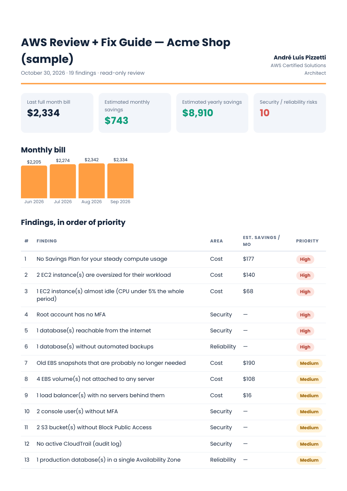

# AWS Cost & Architecture Review Kit

A small, **read-only** toolkit to find waste and risks in an AWS account and turn them into a prioritized report.

- Finds idle and oversized EC2, unattached EBS volumes, old snapshots, unused Elastic IPs, empty load balancers, missing Savings Plans and S3 buckets with no lifecycle rule.
- Flags security and reliability gaps: root without MFA, console users without MFA, old access keys, public databases, buckets without Block Public Access, no CloudTrail, no GuardDuty, databases without backups or in a single AZ.
- Produces a clean PDF report with estimated monthly savings and a step-by-step fix guide.



> The sample above uses a **fictional** company and example numbers. See the full PDF in [`sample/`](sample/sample_report_acme_shop.pdf).

## Why it is safe to run

| Concern | How the kit handles it |
|---|---|
| Changing resources by accident | The collector wraps every AWS client and **refuses any call that is not `describe_*`, `list_*` or `get_*`** (see `ReadOnlyClient` in `collector/collect.py`). |
| Reading customer data | The CloudFormation role uses the AWS-managed `ViewOnlyAccess` policy and **explicitly denies** `s3:GetObject`, `secretsmanager:GetSecretValue`, `ssm:GetParameter*`, `kms:Decrypt` and DynamoDB reads. |
| Sharing sensitive identifiers | Output is anonymized before zipping: account IDs, IP addresses, e-mails and IAM user names are replaced by aliases. The alias map stays on your machine. |
| Long-lived access | The role has a 1-hour session limit and is removed by deleting one CloudFormation stack. |

## Quick start

### 1. Create the read-only role (in the account being reviewed)
CloudFormation → Create stack → upload [`client/readonly-review-role.yaml`](client/readonly-review-role.yaml).
Parameters: the reviewer's AWS account ID and a secret External ID. Copy the `RoleArn` output.
A plain-English guide is in [`client/CLIENT_GUIDE.md`](client/CLIENT_GUIDE.md).

> Reviewing your own account? Use your own account ID as `ReviewerAccountId`.

### 2. Collect (from the reviewer's machine)
```bash
python3 -m pip install -r collector/requirements.txt
python3 collector/collect.py \
  --role-arn arn:aws:iam::123456789012:role/ReadOnlyCostArchitectureReview \
  --external-id "your-secret-phrase" \
  --client acme --profile reviewer
```
Output: `review_acme_<date>/review_acme_<date>_anonymized.zip` (plus a private alias map).

### 3. Analyze and build the report
```bash
python3 -m pip install playwright && python3 -m playwright install chromium   # only for PDF output
python3 analyzer/analyze.py review_acme_<date>/review_acme_<date>_anonymized.zip \
  --client "Acme" --package premium
```
`--package basic` shows cost findings only, `standard` adds security and reliability, `premium` adds the step-by-step fix guide.

Try it without an AWS account:
```bash
python3 analyzer/analyze.py sample/review_acme_sample_anonymized.zip --client "Acme (sample)" --package premium
```

## Limitations (read before trusting the numbers)
- Savings are **estimates** based on us-east-1 list prices (or Compute Optimizer when enabled). Check large items in the AWS Pricing Calculator.
- CPU-based rightsizing ignores memory. Look at memory metrics (CloudWatch agent) before downsizing.
- Snapshot savings are an upper bound: snapshots are incremental.
- Every finding needs a human look before anyone acts on it.

## Want it done for you?

I'm André Luís Pizzetti, an AWS Certified Solutions Architect with 25+ years in tech. If you'd rather have an expert run the review, interpret the results and hand you a clear plan:

- **AWS cost & architecture review:** https://www.fiverr.com/alpizzetti/review-your-aws-architecture-and-cut-your-aws-bill
- **AWS architecture diagrams:** https://www.fiverr.com/alpizzetti/create-clear-aws-architecture-diagrams-for-your-cloud

## License
MIT © 2026 André Luís Pizzetti
